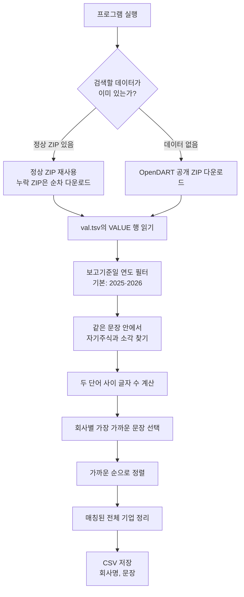

# 검색 과정 안내

이 프로그램은 공시 원문을 한 건씩 API로 요청하지 않습니다. OpenDART에서 공개하는 XBRL 주석 ZIP 안의 `val.tsv`를 컴퓨터에서 검색합니다. API 키와 API 사용 quota는 필요하지 않습니다.

## 실행 흐름 한눈에 보기



## 단계별 설명

1. **입력 자료 선택**: 직접 지정한 데이터가 있으면 그것을 사용합니다. 기본 실행은 프로젝트 루트의 `opendart_dataset/`에서 ZIP을 확인하고, 정상 ZIP은 재사용하며 누락된 ZIP은 순서대로 내려받습니다. ZIP이 하나도 없으면 기존 `val.tsv`를 확인합니다. `--no-download`를 지정하면 내려받지 않습니다.
2. **검색 범위 확인**: 기본 보고기준일 연도는 2025년과 2026년입니다. `--report-year`로 지정하거나 `--all-years`로 연도 제한을 해제할 수 있습니다.
3. **문장 검색**: `VALUE` 안에서 두 키워드가 같은 문장에 나타나는지 확인합니다. 서로 다른 문장에 하나씩만 있으면 결과로 잡지 않습니다.
4. **가까운 정도 계산**: 키워드 사이에 있는 글자 수를 셉니다. `자기주식소각`은 0자 간격이고, `자기주식 소각`은 1자 간격입니다. 단어 순서는 어느 쪽이 먼저여도 괜찮습니다.
5. **기업별 정리**: 같은 기업이 여러 보고서에 있으면 가장 가까운 문장 하나를 대표 결과로 선택합니다. 기업명은 함께 제공되는 OpenDART 기업명 목록을 우선 사용합니다.
6. **CSV 내보내기**: 검색 범위에서 조건에 맞는 전체 기업을 가까운 순으로 저장합니다. 파일에는 `회사명`, `문장` 두 컬럼만 있습니다.

## 실행 예시

```sh
source .venv/bin/activate
python search_keyword_sentences.py
```

기존 자료만 사용하고, 없으면 종료:

```sh
python search_keyword_sentences.py --no-download
```

특정 TSV나 ZIP을 직접 지정:

```sh
python search_keyword_sentences.py --dataset /path/to/val.tsv
```

## 결과 범위 읽기

- 결과는 실제로 찾은 ZIP 또는 TSV에 들어 있는 자료만 반영합니다.
- 기본 실행은 공식 ZIP 누락분을 내려받으므로 전체 사용 가능 묶음을 검색합니다. `--no-download`로 일부 ZIP만 검색하면 빠진 묶음을 안내합니다. 데이터가 일부뿐인데 전체 공시를 검색했다고 말하지 않습니다.
- 현재 공식 목록에서 2026년 2분기 ZIP을 사용할 수 없습니다.
- 키워드가 문장에 함께 있다는 것은 문자열 검색 결과입니다. 해당 문장이 실제 소각 완료를 뜻하는지, 계획·조건·과거 설명인지는 원문을 확인해야 합니다.
- 결과는 선택한 연도와 실제 검색 데이터에 존재하는 조건 일치 기업 전체입니다.
