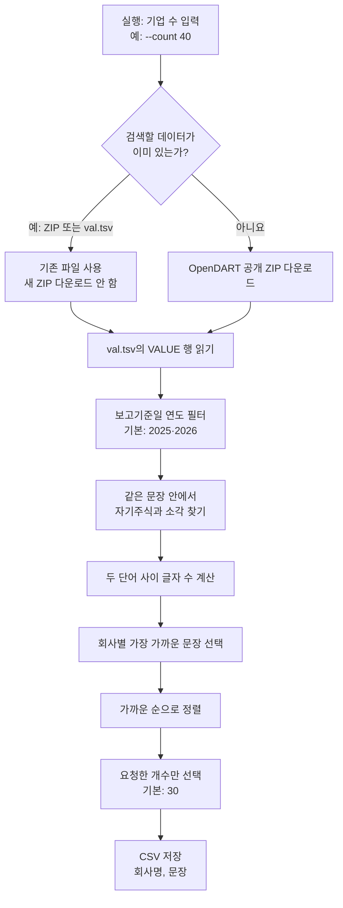

# 검색 과정 안내

이 프로그램은 공시 원문을 한 건씩 API로 요청하지 않습니다. OpenDART에서 공개하는 XBRL 주석 ZIP 안의 `val.tsv`를 컴퓨터에서 검색합니다. API 키와 API 사용 quota는 필요하지 않습니다.

## 실행 흐름 한눈에 보기



## 단계별 설명

1. **요청 개수 결정**: `--count` 뒤에 CSV에 저장할 기업 수를 씁니다. 생략하면 30개입니다.
2. **입력 자료 선택**: 직접 지정한 데이터가 있으면 그것을 사용합니다. 그렇지 않으면 프로젝트의 ZIP을 먼저 찾고, 다음으로 기존 `val.tsv`를 확인합니다. 어느 것도 없을 때만 ZIP을 내려받습니다.
3. **검색 범위 확인**: 기본 보고기준일 연도는 2025년과 2026년입니다. `--report-year`로 바꾸거나 `--all-years`로 연도 제한을 해제할 수 있습니다.
4. **문장 검색**: `VALUE` 안에서 두 키워드가 같은 문장에 나타나는지 확인합니다. 서로 다른 문장에 하나씩만 있으면 결과로 잡지 않습니다.
5. **가까운 정도 계산**: 키워드 사이에 있는 글자 수를 셉니다. `자기주식소각`은 0자 간격이고, `자기주식 소각`은 1자 간격입니다. 단어 순서는 어느 쪽이 먼저여도 괜찮습니다.
6. **기업별 정리**: 같은 기업이 여러 보고서에 있으면 가장 가까운 문장 하나를 대표 결과로 선택합니다. 기업명은 함께 제공되는 OpenDART 기업명 목록을 우선 사용합니다.
7. **CSV 내보내기**: 가까운 순으로 정렬한 뒤 지정한 수만큼 저장합니다. 파일에는 `회사명`, `문장` 두 컬럼만 있습니다.

## 실행 예시

```sh
source .venv/bin/activate
python search_keyword_sentences.py --count 30
python search_keyword_sentences.py --count 40
```

기존 자료만 사용하고, 없으면 종료:

```sh
python search_keyword_sentences.py --no-download
```

특정 TSV나 ZIP을 직접 지정:

```sh
python search_keyword_sentences.py --dataset /path/to/val.tsv --count 40
```

## 결과 범위 읽기

- 결과는 실제로 찾은 ZIP 또는 TSV에 들어 있는 자료만 반영합니다.
- 일부 ZIP만 있다면 있는 파일만 검색하고, 빠진 공식 묶음을 안내합니다. 데이터가 일부뿐인데 전체 공시를 검색했다고 말하지 않습니다.
- 현재 공식 목록에서 2026년 2분기 ZIP을 사용할 수 없습니다.
- 키워드가 문장에 함께 있다는 것은 문자열 검색 결과입니다. 해당 문장이 실제 소각 완료를 뜻하는지, 계획·조건·과거 설명인지는 원문을 확인해야 합니다.
- `--count 40`을 줘도 결과 기업이 40개 미만이면 존재하는 결과만 저장하고 그 사실을 알려줍니다.
